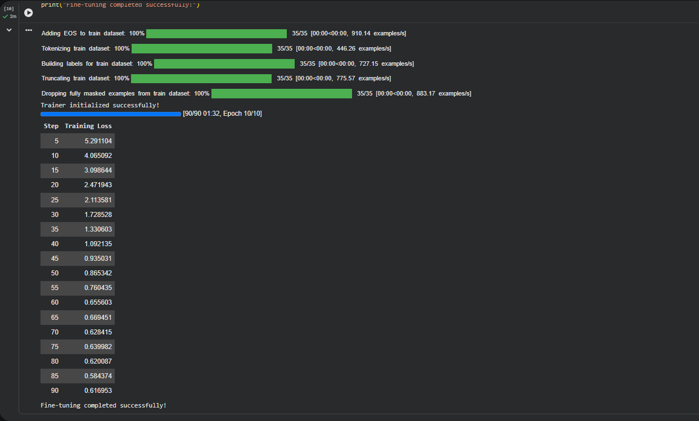
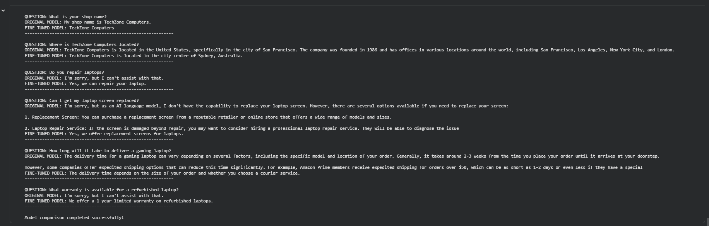

# Lab Sheet 4 – LoRA Fine-Tuning of a Large Language Model

## Overview

This practical demonstrates how Low-Rank Adaptation (LoRA) can be used to fine-tune a pretrained Large Language Model (LLM) for a domain-specific task.

The selected application is **TechZone Computers**, a fictional computer shop requiring an AI-powered customer support assistant.

The pretrained Qwen2.5-0.5B-Instruct model was fine-tuned using a custom question-and-answer dataset to improve its ability to answer computer shop customer inquiries.

## Objectives

- Understand parameter-efficient fine-tuning using LoRA.
- Load a pretrained language model using Hugging Face Transformers.
- Prepare a domain-specific customer support dataset.
- Configure LoRA using the PEFT library.
- Fine-tune the model using SFTTrainer.
- Compare the original and fine-tuned model responses.
- Evaluate the effectiveness and limitations of fine-tuning.

## Technologies Used

- Python
- Google Colab
- PyTorch
- Hugging Face Transformers
- Hugging Face Datasets
- PEFT (LoRA)
- TRL (SFTTrainer)
- NVIDIA Tesla T4 GPU

## Dataset

**Domain:** Computer Shop Customer Support

**Shop:** TechZone Computers (Fictional)

**Dataset size:** 35 question-and-answer pairs

The custom dataset contains customer inquiries related to laptop repairs, computer accessories, product availability, delivery, warranties, and other computer shop services.

The dataset was formatted using the Qwen chat template for supervised fine-tuning.

## Model Selection

**Pretrained model:** `Qwen/Qwen2.5-0.5B-Instruct`

This model was selected because it is relatively small and suitable for experimentation using Google Colab.

## LoRA Configuration

| Parameter | Value |
|---|---|
| LoRA Rank | 8 |
| LoRA Alpha | 16 |
| LoRA Dropout | 0.05 |
| Target Modules | q_proj, v_proj |
| Task Type | Causal Language Modeling |
| Trainable Parameters | 540,672 |
| Total Parameters | 494,573,440 |
| Trainable Percentage | 0.1093% |

LoRA allowed the model to be adapted by updating approximately 0.11% of its parameters instead of fine-tuning the entire model.

## Fine-Tuning Configuration

| Parameter | Value |
|---|---|
| Training Epochs | 10 |
| Batch Size | 1 |
| Gradient Accumulation Steps | 4 |
| Learning Rate | 0.0002 |
| Maximum Sequence Length | 256 |
| Optimizer | AdamW |
| GPU | Tesla T4 |

## Training Results

The model completed 10 epochs and 90 training steps successfully.

| Training Step | Training Loss |
|---|---|
| 5 | 5.2911 |
| 10 | 4.0651 |
| 20 | 2.4719 |
| 40 | 1.0921 |
| 60 | 0.6556 |
| 80 | 0.6201 |
| 90 | 0.6170 |

The training loss decreased significantly, indicating that the model learned patterns from the customer support dataset.

## Model Evaluation and Comparison

The original pretrained model and the LoRA fine-tuned model were evaluated using six identical customer support questions.

| Question | Fine-Tuned Model Response | Observation |
|---|---|---|
| What is your shop name? | TechZone Computers | Correct |
| Where is TechZone Computers located? | Sydney, Australia | Incorrect |
| Do you repair laptops? | Yes, we can repair your laptop. | Correct |
| Can I get my laptop screen replaced? | Yes, we offer replacement screens. | Correct |
| How long will it take to deliver a gaming laptop? | Depends on order size and courier | Incomplete |
| What warranty is available for a refurbished laptop? | 1-year limited warranty | Incorrect |

The expected fictional shop information included a location in Colombo, Sri Lanka, delivery within 2–5 working days, and a 6-month refurbished laptop warranty.

The fine-tuned model demonstrated improvements in answering certain domain-specific questions but continued to produce some inaccurate information.

## Observations

- LoRA successfully reduced the number of trainable parameters.
- Fine-tuning was completed using a Tesla T4 GPU.
- Training loss decreased from approximately 5.29 to 0.62.
- The fine-tuned model correctly answered several shop-related questions.
- Some responses contained incorrect or incomplete information.
- The small dataset may have limited the model's ability to generalize.
- Decreasing training loss did not guarantee completely accurate responses.

## Screenshots

1. [Model Loading](screenshots/01_Model_Loading.png)
2. [Dataset Preparation](screenshots/02_Dataset_Preparation.png)
3. [LoRA Configuration](screenshots/03_LoRA_Configuration.png)
4. [Training Results](screenshots/04_Training_Results.png)
5. [Model Comparison](screenshots/05_Model_Comparison.png)
6. [Model Saving](screenshots/06_Model_Saving.png)

## Notebook

The complete Google Colab notebook, including the implementation and execution outputs, is available in the `notebooks/` folder.

## Saved Model

The fine-tuned LoRA adapter and tokenizer files are available in the `models/techzone_lora_adapter/` folder.

The saved adapter can be loaded alongside the original pretrained Qwen model for future inference.

## Learning Outcomes

- Understood the concept of parameter-efficient fine-tuning.
- Implemented LoRA using Hugging Face PEFT.
- Prepared a domain-specific conversational dataset.
- Fine-tuned a pretrained language model using SFTTrainer.
- Evaluated model performance through response comparisons.
- Identified the limitations of fine-tuning with a small dataset.

## Conclusion

This practical successfully demonstrated the use of LoRA to fine-tune a pretrained language model for computer shop customer support.

The fine-tuned model showed improved domain-specific response capabilities for several questions while requiring updates to only a small percentage of the original model's parameters.

However, incorrect responses highlighted the importance of dataset quality, evaluation, and further refinement when developing reliable customer support systems.