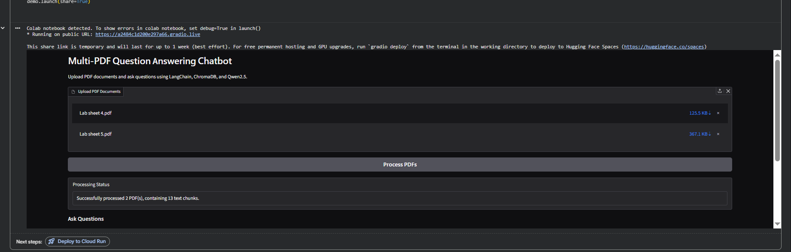
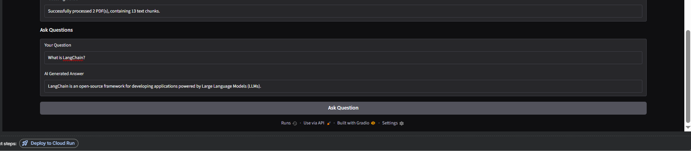
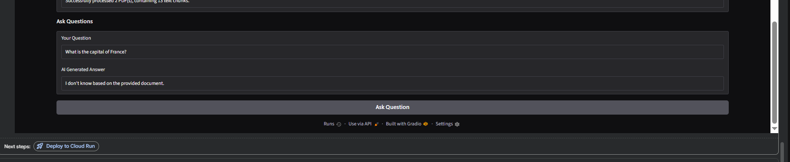

# Lab Sheet 5 – Retrieval-Augmented Generation (RAG) Architecture

## 1. Introduction

This project demonstrates the implementation of a Retrieval-Augmented Generation (RAG) system for document-based question answering.

The system allows users to upload multiple PDF documents, process their contents, and ask questions based on the information available in those documents.

The chatbot combines document retrieval with a Large Language Model (LLM) to generate context-aware answers while reducing responses to unrelated questions.

## 2. Objectives

- Understand the architecture and workflow of Retrieval-Augmented Generation (RAG).
- Extract and process text from PDF documents.
- Split documents into smaller text chunks.
- Generate embeddings and store them in a vector database.
- Retrieve relevant document content based on user questions.
- Generate answers using a Large Language Model.
- Develop an interactive chatbot supporting multiple PDF uploads.
- Evaluate the chatbot using relevant and unrelated questions.

## 3. Technologies Used

| Technology | Purpose |
|---|---|
| Python | Main programming language |
| Google Colab | Development and execution environment |
| LangChain | Document processing and retrieval |
| PyPDFLoader | PDF text extraction |
| ChromaDB | Vector database |
| Hugging Face Sentence Transformers | Text embeddings |
| Qwen2.5-0.5B-Instruct | Answer generation |
| Gradio | Interactive web interface |
| PyTorch | Model execution with GPU support |

## 4. System Architecture

The RAG system follows the workflow below:

**PDF Upload → Text Extraction → Text Chunking → Embedding Generation → ChromaDB Storage → Relevant Document Retrieval → LLM Answer Generation → Chatbot Response**

### Step 1: PDF Upload

Users upload PDF documents through the Gradio interface.

### Step 2: Text Extraction

PyPDFLoader extracts the textual content from the uploaded PDF files.

### Step 3: Text Chunking

The extracted documents are divided into smaller chunks using RecursiveCharacterTextSplitter.

Configuration:
- Chunk size: 700 characters
- Chunk overlap: 100 characters

### Step 4: Embedding Generation

The `sentence-transformers/all-MiniLM-L6-v2` model converts document chunks into numerical vector representations.

### Step 5: Vector Storage

The generated embeddings and corresponding document chunks are stored in ChromaDB.

### Step 6: Document Retrieval

When a user submits a question, the system searches ChromaDB for the most relevant document chunks.

### Step 7: Answer Generation

The retrieved information is provided as context to the `Qwen/Qwen2.5-0.5B-Instruct` language model.

The model generates an answer using the retrieved document information.

### Step 8: Relevance Filtering

A distance-based relevance filter helps the system reject questions that are not sufficiently related to the uploaded documents.

### Step 9: Gradio Interface

The Gradio interface allows users to:
- Upload multiple PDF files.
- Process uploaded documents.
- Ask questions about their contents.
- View AI-generated answers.

## 5. Implementation

The project was developed in Google Colab using a Tesla T4 GPU.

The implementation includes:

1. Installing and importing the required Python libraries.
2. Loading PDF documents.
3. Extracting and splitting document text.
4. Generating embeddings.
5. Creating a ChromaDB vector store.
6. Implementing similarity-based document retrieval.
7. Loading the Qwen language model.
8. Developing the RAG question-answering function.
9. Implementing relevance filtering.
10. Creating a Gradio chatbot with multi-PDF upload support.

## 6. Testing and Results

The chatbot was tested using Lab Sheet 4 and Lab Sheet 5 PDF documents.

### Test 1 – Multiple PDF Processing

**Input:** Two PDF documents

**Result:** Successfully processed 2 PDF files, containing 13 text chunks.

**Status:** Passed



### Test 2 – Relevant Question

**Question:** What is LangChain?

**Generated Answer:**

> LangChain is an open-source framework for developing applications powered by Large Language Models (LLMs).

**Status:** Passed



### Test 3 – Unrelated Question

**Question:** What is the capital of France?

**Generated Answer:**

> I don't know based on the provided document.

**Status:** Passed



## 7. Project Structure

```text
Lab Sheet 5/
├── LabSheet5_RAG_Architecture.ipynb
├── README.md
└── screenshots/
    ├── 01_pdf_processing.png
    ├── 02_correct_answer.png
    └── 03_unrelated_question.png
```

## 8. How to Run

1. Open `LabSheet5_RAG_Architecture.ipynb` in Google Colab.
2. Enable the T4 GPU under Runtime settings.
3. Run the installation and setup cells.
4. Upload a sample PDF when prompted during the initial document-loading stage.
5. Run the document processing, embedding, and language model cells.
6. Run the Gradio interface cell.
7. Upload one or more PDFs through the chatbot interface.
8. Click **Process PDFs**.
9. Enter a question and click **Ask Question**.
10. View the generated answer.

**Note:** The Gradio sharing URL is temporary and requires an active Colab runtime.

## 9. Limitations

- The chatbot depends on the quality and relevance of extracted PDF text.
- Scanned PDFs may require OCR before their contents can be processed.
- The relevance filter uses a fixed similarity-distance threshold and may occasionally reject relevant questions or accept unrelated ones.
- Model performance depends on the available GPU resources.
- The Colab implementation uses Hugging Face models and Gradio instead of the original lab's Ollama and Streamlit setup.

## 10. Conclusion

This project demonstrates a functional Retrieval-Augmented Generation system capable of processing multiple PDF documents and answering questions using retrieved document information.

The implementation combines LangChain, Hugging Face embeddings, ChromaDB, Qwen2.5, and Gradio into a document-based question-answering chatbot.

Testing demonstrated successful multi-PDF processing, relevant question answering, and rejection of an unrelated question.